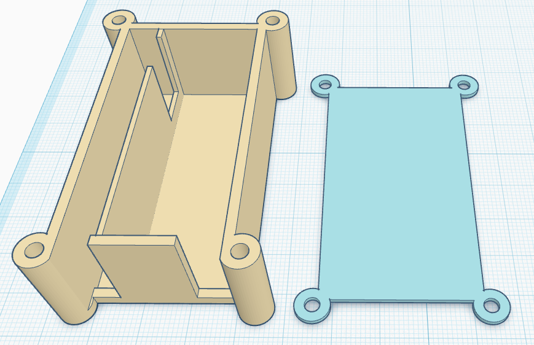
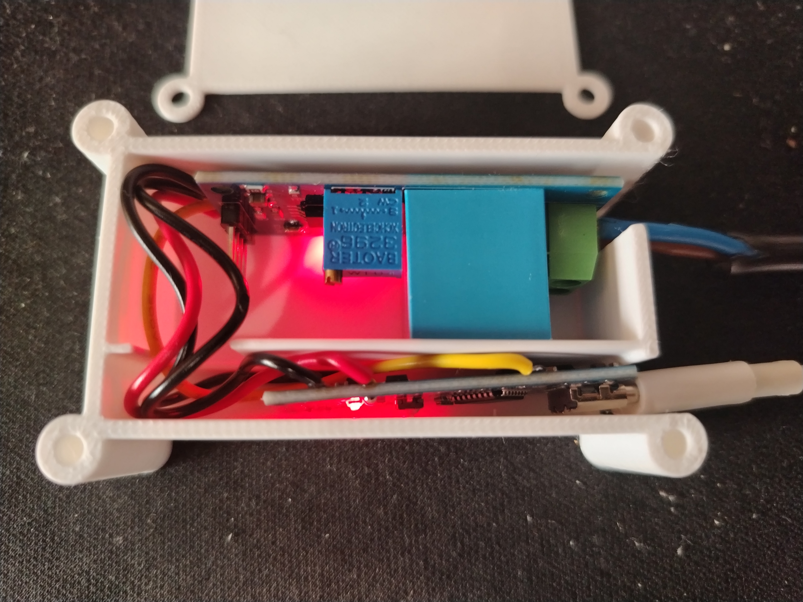

# Описание

Простейший вольтметр на Arduino Nano и ZMPT101B.

Использую для детектирования отключения электроэнергии на домашнем сервере.

На сервере работает скрипт `watchdog_acc.sh` который при обнаружении занижения напряжения (или его отсутствии)
на протяжении некоторого времени выполняет завершение работы через утилиту `shutdown`.

В моём случае я решал проблему отсутствия связи ИБП и сервера. Вольтметр подключен к обычной розетке
220в. Сервер к источнику бесперебойного питания (ИБП).
Т.е если произошло отключение электроэнергии, то N минут сервер работает от ИБП, а если в течении этих
N минут электричество не появилось - корректно завершает работу. Информацию о текущем напряжении
получает через последовательный порт.

# Прошивка (PlatformIO)

`pio run -t upload`

# Корупс

STL файлы для печати корпуса располагаются в каталоге `./3d`.

